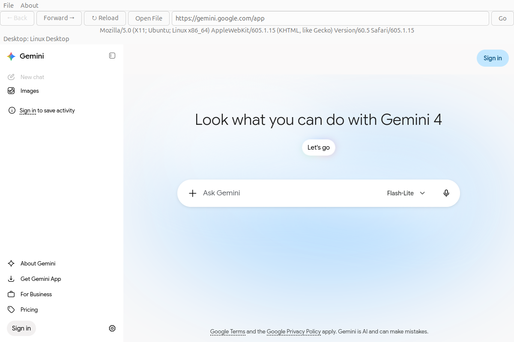
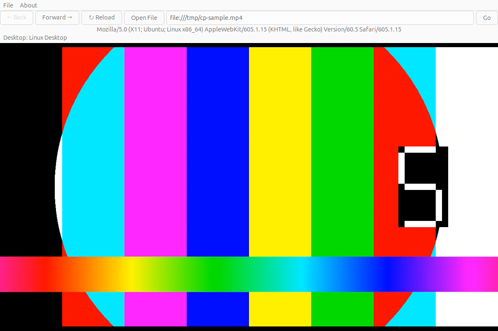

# cloud-player - Gemini and local video on Windows, macOS, and Linux Desktop


[-purple.svg)](https://github.com/cloudgen/ciao)
[](https://github.com/cloudgen/cloud-player)
[](https://www.gtk.org/)
[](https://webkitgtk.org/)

You run `cloud-player` on your own Linux login. When that login is Linux Desktop, the program opens one window on [Gemini](https://gemini.google.com). The same program answers `windows`, `macos`, or `linux-desktop`, so those three stay distinct.

| | |
|---|---|
| **You** | You start the program on your own login. The window, its cookies, and its logs stay in that login's app folder. |
| **The program** | On Linux Desktop it shows the Gemini page, keeps an address bar, and shows a local `.mp4` when you submit that address. Asked to name the desktop, it prints one of `windows`, `macos`, or `linux-desktop`. |
| **Not this** | It is not a general browser, and a click inside the page does not start the video view. The Linux window opens only on Linux Desktop. This repository does not produce a macOS build. |

**Includes:** the Gemini start page, Back / Forward / Reload, Open File, an address bar, a user-agent menu, cookies for this window, local `.mp4` playback when the address ends in `.mp4`, and one desktop name: `windows`, `macos`, or `linux-desktop`.

**Excludes:** playback from a click on a file inside the page, video types other than `.mp4`, a numbered menu in the terminal, and a macOS build. Wayland-only, with no `DISPLAY` or with `GDK_BACKEND` set and not containing `x11`, is not Linux Desktop and does not open the Linux window.

| Step | What it means | What you type |
|------|----------------|---------------|
| Build | Install the development packages, then compile. The install step uses `sudo` for packages and, if it is missing, the sol2 header. The build downloads the mpv client library into `third_party/libmpv`, which is not part of the git tree. | `./build.sh install` then `./build.sh build` |
| Name | The program prints one token and exits. It does not open the window. | `./target/exe/debug/cloud-player desktop` |
| Open | On Linux Desktop the window opens on the Gemini start page. The title is **cloud-player - Linux Desktop**. Nothing is installed onto the system path. | `./target/exe/debug/cloud-player` |
| Play | Type the address in the bar and press Enter or Go. An address that ends in `.mp4` plays in the video view. Any other address opens in the page. | `file:///path/to/clip.mp4` in the address bar |

## Features

- One decision names exactly one of `windows`, `macos`, or `linux-desktop`. The labels are Windows, macOS, and Linux Desktop.
- Linux Desktop means a Linux build, a non-empty `DISPLAY`, and `GDK_BACKEND` either unset or a list that contains the token `x11`. An empty `GDK_BACKEND` is set to `x11` before the window opens.
- `WAYLAND_DISPLAY` and `XDG_SESSION_TYPE` do not change that name.
- The GTK 3 window, using WebKitGTK 4.1, opens only for Linux Desktop. The title adds ` - Linux Desktop`, and the window shows **Desktop: Linux Desktop**.
- Address bar with Back, Forward, Reload, Open File, and Go. Enter does the same thing as Go. Open File asks for one local file, writes that file's address into the bar, and then does the same thing as Go. The Windows window has the same bar.
- On Linux Desktop, a submitted address that ends in `.mp4` plays through libmpv in the window. On Windows, that address plays in the WebView2 window. Query strings are ignored when deciding that suffix (`clip.mp4?unused=1` still counts).
- A click on a link or a file inside the page stays in the page. It does not start the video view.
- Cookies and the last user-agent choice are stored under `~/.app/cloud-player/`.
- User-agent menu: Webview (default), Chrome, Firefox, Safari, and Edge.
- Log and Lua-script commands from `cloud-player help`. With no command, the window opens on Linux Desktop.
- Version **1.2.0**, from `src/main/cpp/project.h`. The Windows program uses the same version.

## Quick Installation

Primary build, from a clone of this repository:

```bash
./build.sh install
./build.sh build
./target/exe/debug/cloud-player
```

`./build.sh install` runs `sudo apt` for `build-essential`, `pkg-config`, `libgtk-3-dev`, `libwebkit2gtk-4.1-dev`, `libsqlite3-dev`, `libglib2.0-dev`, `liblua5.3-dev`, `lua5.3`, `libepoxy-dev`, `libegl1-mesa-dev`, and `git`. If `/usr/local/include/sol/sol.hpp` is missing, it clones [sol2](https://github.com/ThePhD/sol2) and copies that header into `/usr/local/include/sol/`. Sourcing `project.sh` exports paths and does not install packages. Running `project.sh` as a program does.

`./build.sh build` downloads `libmpv2` and `libmpv-dev` into `third_party/libmpv` when they are not already there, then compiles every C and C++ file under `src/` into `target/exe/debug/cloud-player`. Object files go under `target/exe/debug/obj/`. The link step uses the host multiarch directory for libmpv and also asks `pkg-config` for `epoxy` and `egl`. There is no online install script and no checksum sidecar.

Meson compiles the same sources:

```bash
meson setup builddir --buildtype=debug
meson compile -C builddir
./builddir/cloud-player
```

After `./build.sh build` has fetched libmpv, these Linux builds write the same program path:

```bash
ant compile
gradle linkDebug --offline
```

`ant compile` is the Ant compile. `ant install` rewrites `project.sh` and installs packages; day-to-day builds use `./build.sh`.

Windows, from the same tree, on a machine with Visual Studio 2022 and the WebView2 Evergreen runtime:

```bat
build-win.bat
build-win\Debug\cloud-player.exe
```

`build-win.bat` calls the Visual Studio 2022 developer environment, then CMake with the Visual Studio 2022 generator, and writes `build-win\Debug\cloud-player.exe` beside `WebView2Loader.dll`. It does not run `./build.sh`. `cloud-player.exe --check` creates the profile under `%USERPROFILE%\.app\cloud-player\` and exits without a window. Open File sits beside Reload. A submitted address whose path ends in `.mp4` plays in that window.

## Usage

Run `./target/exe/debug/cloud-player` with no arguments to open the window on Linux Desktop. The start page is `https://gemini.google.com`. The binary name is `cloud-player`. The title on the window is **cloud-player - Linux Desktop**.

```text
./target/exe/debug/cloud-player desktop
./target/exe/debug/cloud-player desktopcheck --os linux --display :0
./target/exe/debug/cloud-player help
./target/exe/debug/cloud-player --config config-sample.conf
./target/exe/debug/cloud-player --shutdown=3600
./target/exe/debug/cloud-player log list
```

| Command or option | What it does |
|-------------------|--------------|
| `desktop` | Print `windows`, `macos`, or `linux-desktop` for this process, then exit. No window. Exit 0 for those three. Exit 1 prints `unknown` and a `Next:` line. |
| `desktopcheck --os windows\|macos\|linux` | Name that desktop from the flags you pass. It does not read this process. Listed under Tests in help. |
| `--display`, `--gdk-backend` | Used with `desktopcheck --os linux`. Linux Desktop needs a non-empty display and either no backend or a backend list that contains `x11`. |
| `--wayland`, `--session-type` | Accepted by `desktopcheck` and ignored by the decision. |
| `--json` / `JSON=1` | One JSON object. Success is `{"desktop":"…","label":"…"}`. Failure adds `"error"`. This also quiets ordinary messages. |
| `help` | Print commands and options, then exit. |
| `--config <path>` | Load that config file instead of `~/.app/cloud-player/config.conf`. |
| `--quiet` / `QUIET=1` | Hide non-error messages. |
| `--shutdown=N` / `SHUTDOWN=N` | Close the window after N seconds. `0` means do not close on a timer. |
| `--bookmark=N` / `BOOKMARK=N` | Startup bookmark index. `0` is the Gemini start page. |
| `DEBUG=1` | Also print debug lines. |
| `log list` / `log show N` / `log folder` / `log clear` | List, print, locate, or delete log files, then exit. |
| `luascript list` / `luascript folder` / `luascript view N` / `luascript new NAME` | Inspect or create Lua userscripts, then exit. |

Logs for a normal login are `~/.app/cloud-player/log/cloud-player-YYYYMMDD.log`. Cookies are `~/.app/cloud-player/cookies/cookies.sqlite`.

To play a file, put an address that ends in `.mp4` in the bar and press Enter or Go. The page hides and the video view shows the picture. Submit any other address to go back to the page.

If this process is not Linux Desktop, the window does not open. The program prints what happened and a `Next:` line, then exits 1.

## Examples

Gemini in the cloud-player window, before you sign in. This capture used a fresh app folder, so it is not a signed-in session. The bar shows Back, Forward, Reload, Open File, and Go. The line under the address bar reads **Desktop: Linux Desktop**.



The same window after the address bar was given `file:///tmp/cp-sample.mp4` and Enter. Open File stays on the bar. The picture is a generated color-bar clip, not a personal video.



```bash
./target/exe/debug/cloud-player desktop
./target/exe/debug/cloud-player --json desktopcheck --os macos
```

The second command prints:

```json
{"desktop":"macos","label":"macOS"}
```

Then, on Linux Desktop, open the window:

```bash
./target/exe/debug/cloud-player
```

In the address bar:

```text
file:///path/to/clip.mp4
```

Press Enter. The video view opens. A click on `clip.mp4` inside a directory listing does not do this. Paste or type the address and press Enter or Go.

## Platform Compatibility

| Environment | Status |
|-------------|--------|
| Linux x86_64, `DISPLAY` set, `GDK_BACKEND` unset or containing `x11` | Linux Desktop. This is the build that produced the binary and the pictures above (GTK 3.24, WebKitGTK 2.52). |
| Linux with `GDK_BACKEND` set and not containing `x11`, or with `DISPLAY` empty | Not Linux Desktop. The program exits before the window. `WAYLAND_DISPLAY` alone does not make it Linux Desktop. |
| Debian or Ubuntu package names | The install commands above use `apt`. |
| macOS | The check answers `macos` / macOS. This repository does not produce a macOS build. |
| Windows x64, Visual Studio 2022, WebView2 Evergreen runtime | `build-win.bat` produces `build-win\Debug\cloud-player.exe`. The window is Win32 and WebView2. Open File is on the address bar. An address ending in `.mp4` plays in that window. |
| Terminal-only use | `desktop`, `desktopcheck`, `help`, `log`, and `luascript` run without keeping the window open. Watching a video needs the Linux Desktop window or `cloud-player.exe` on Windows. |

## Related Projects

- [CIAO](https://github.com/cloudgen/ciao) — the defensive style this tree is written in.
- [Gemini](https://gemini.google.com) — the page the window opens.
- [mpv](https://mpv.io/) — the library behind the `.mp4` view. This repo downloads the client library at build time and does not vendor the mpv sources.

## Contributing

Open an issue or a pull request on [cloudgen/cloud-player](https://github.com/cloudgen/cloud-player). Please keep behavior changes aligned with `src/main/cpp/project.h` and say what a person actually sees.

Report security-sensitive bugs in private. The address and the preferred channel are in [SECURITY.md](SECURITY.md).

## License

[MIT](LICENSE.md). Copyright (c) 2026 Wong Chun Fai, aka: Cloudgen (cloudgen.wong@gmail.com).

## Last Update

2026-10-16 — product docs for 1.2.0. Windows builds `cloud-player.exe` with Visual Studio 2022. Open File is on that address bar. The pictures are the Linux window, with Open File and a local `.mp4`. The version badge matches `src/main/cpp/project.h`.
